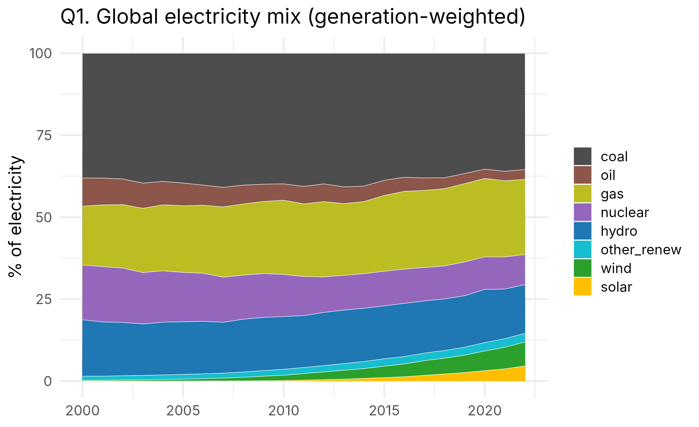
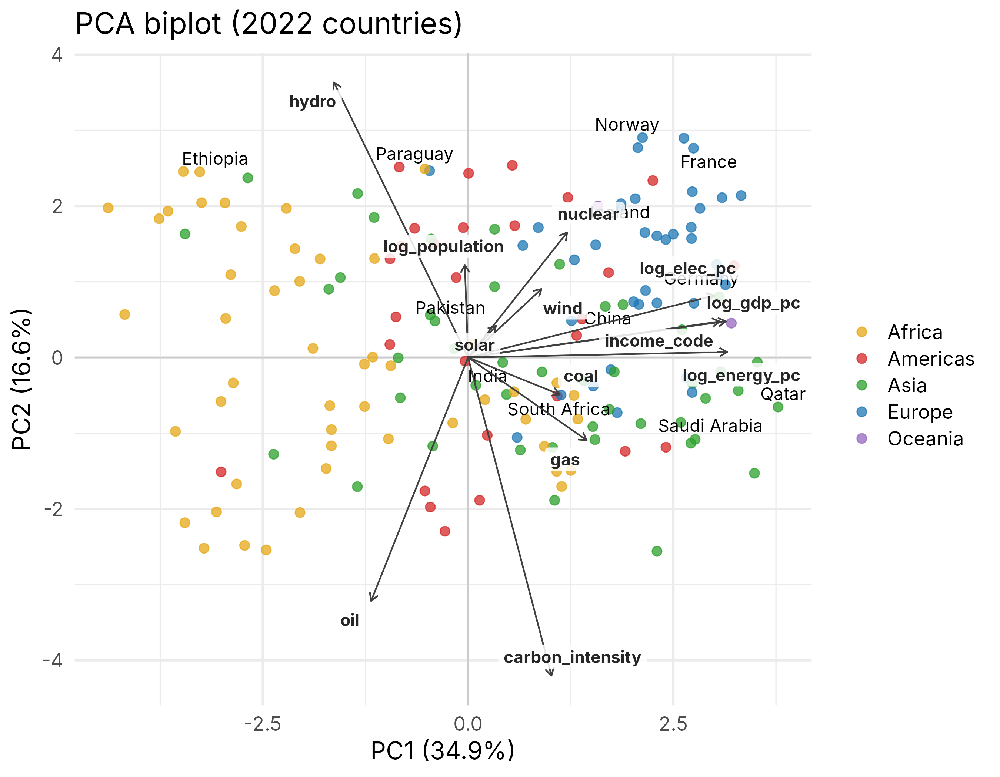

# What drives the shift to renewable electricity?
### Data Exploration & Preparation (DEP) project – Energy domain

**Numan Liaqat – Roll No. 2023461**

Exploring 23 years (2000–2022) of country-level energy data to see how the world's
electricity mix is changing, whether wealth explains clean power, and which features
really matter once PCA strips out the redundancy.

## Data
- **Source:** Our World in Data – Energy dataset (Ritchie, Rosado and Roser, 2023), https://github.com/owid/energy-data
- **Raw:** 23,377 rows × 130 columns (countries + regional aggregates, 1900–2025)
- **After cleaning:** 3,790 rows × 20 columns (165 countries, 2000–2022)

The raw csv is not committed (9 MB). `R/01_load_inspect.R` downloads it into `data/raw/` automatically.

## How to run
```r
install.packages(c("dplyr", "tidyr", "ggplot2", "ggrepel", "corrplot",
                   "countrycode", "factoextra", "scales"))
```
Then from the project folder:
```
Rscript run_all.R
```

## Pipeline
| Script | What it does |
|---|---|
| `R/01_load_inspect.R` | download + size, types, missing values, aggregate rows |
| `R/02_cleaning.R` | drop aggregates, keep 2000–2022, select columns, interpolate gaps, add GDP per capita + continent |
| `R/03_outliers.R` | IQR outlier detection, skewness check, log transform |
| `R/04_eda.R` | five EDA questions with plots and correlation matrix |
| `R/05_encoding.R` | one-hot (continent) and label encoding (income band) |
| `R/06_pca.R` | PCA on 13 scaled features, scree plot, loadings, biplot |

Figures are written to `outputs/figures/`.

## Key results
| Question | Finding |
|---|---|
| Q1 Global electricity mix | Renewables rose from 18.7% (2000) to 29.4% (2022); wind + solar went from 0.2% to 11.9% |
| Q2 Wealth vs energy use | Very strong link, r = 0.94 (log GDP per capita vs log energy per person) |
| Q3 Wealth vs green power | Weak and negative, r = -0.27. 9 of the 18 countries with >90% renewable power are in Africa (mostly hydro) |
| Q4 Carbon intensity | Americas -31.5%, Oceania -27.9%, Europe -24.7%, Asia only -5.6% |
| Q5 Correlations | Hydro share vs carbon intensity r = -0.81; the log per-capita measures are > 0.9 with each other |
| PCA | 5 components (eigenvalue > 1) keep 82.1% of the variance. PC1 = wealth/consumption, PC2 = clean vs dirty power |




## Poster
The final poster is in `poster/`.
